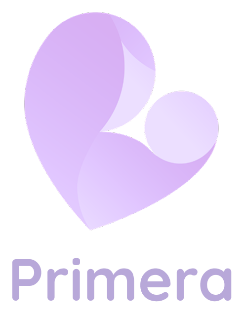

<a id="readme-top"></a>

<div align="center">
  

  <h1>Primera</h1>

  <p>
    An AI-assisted pregnancy support app that brings together wellness logging,
    smartwatch health data, voice input, and personalized goals.
  </p>

  <p>
    <a href="https://github.com/shwalalala/Primera/issues">Report a bug</a>
    ·
    <a href="https://github.com/shwalalala/Primera/issues">Request a feature</a>
  </p>
</div>

[](https://github.com/shwalalala/Primera/graphs/contributors)
[](https://github.com/shwalalala/Primera/network/members)
[](https://github.com/shwalalala/Primera/stargazers)
[](https://github.com/shwalalala/Primera/issues)
[](https://github.com/shwalalala/Primera/actions/workflows/android_ci.yml)

> **Health disclaimer:** Primera is a student software project and is not a medical device or a substitute for professional medical advice, diagnosis, or treatment. Health information and wearable measurements may be incomplete or inaccurate. Contact a qualified healthcare professional about medical concerns; seek urgent care for emergencies.

<details>
  <summary>Table of Contents</summary>
  <ol>
    <li><a href="#about-the-project">About the Project</a></li>
    <li><a href="#features">Features</a></li>
    <li><a href="#built-with">Built With</a></li>
    <li><a href="#getting-started">Getting Started</a></li>
    <li><a href="#usage">Usage</a></li>
    <li><a href="#privacy-and-security">Privacy and Security</a></li>
    <li><a href="#development">Development</a></li>
    <li><a href="#team">Team</a></li>
    <li><a href="#license">License</a></li>
    <li><a href="#acknowledgments">Acknowledgments</a></li>
  </ol>
</details>

## About the Project

Primera is an Android pregnancy-support application developed by team
`2526-sem2-it332-55`. It is intended to make maternal wellness tracking more
convenient by combining manual and voice-assisted health logging with
Health Connect data, progress tracking, and supportive pregnancy information.

The project objectives are to:

1. Improve maternal health entry through smartwatch-based physiological data
   integration.
2. Improve maternal health data entry through AI-assisted speech-to-text
   logging.
3. Support maternal engagement through personalized wellness goals, progress
   tracking, and supportive reinforcement.

## Features

- **Account access:** Sign in, register, and request a password reset using
  Firebase Authentication.
- **Pregnancy dashboard:** View pregnancy progress, a week calendar, health
  summaries, recent logs, baby development information, symptoms, and
  educational content.
- **Health logs and check-ins:** Record and review wellness information.
- **Voice-assisted logging:** Capture speech using Android speech recognition
  and save transcriptions for logging. When configured, Gemini can assist with
  symptom extraction; otherwise, a keyword-based extractor is used.
- **Health Connect integration:** With user permission, read steps, heart rate,
  sleep, and blood oxygen saturation (SpO2) information available through
  Health Connect.
- **Personalized goals:** Add goals and track progress.
- **Insights and reminders:** Access wellness insights and local reminders.
- **Profile and preferences:** Manage profile settings and app preferences.

Availability of wearable measurements depends on the connected device,
Health Connect, granted permissions, and the data recorded by the device.

## Built With

- [](https://kotlinlang.org/)
- [](https://developer.android.com/compose)
- [](https://m3.material.io/)
- [](https://firebase.google.com/products/auth)
- [](https://firebase.google.com/products/firestore)
- [](https://developer.android.com/health-and-fitness/guides/health-connect)
- [](https://github.com/google/generative-ai-android)
- [](https://developer.android.com/)
- [](https://gradle.org/)

## Getting Started

### Prerequisites

- Android Studio with Android SDK support for this project's configured
  `compileSdk` (37).
- JDK 17 or newer. The repository's CI workflow uses JDK 17.
- An Android device or emulator running Android 8.0 (API 26) or newer.
- A Firebase project configured for the Android application ID
  `cit.edu.primera`.
- Health Connect installed and available on the test device to test wearable
  health-data features.

### Setup

1. **Clone the repository.**

   ```bash
   git clone https://github.com/shwalalala/Primera.git
   cd Primera
   ```

2. **Open the project in Android Studio.** Open the repository root and allow
   Gradle to sync and download the required dependencies and Android SDK
   components.

3. **Configure Firebase.** Register an Android app with application ID
   `cit.edu.primera` in your Firebase project. Obtain that project's
   `google-services.json` from Firebase and place it at
   `app/google-services.json`. Configure Firebase Authentication sign-in
   providers as required by your project and deploy/review Firestore rules
   before using real accounts or data.

   The repository currently includes a `google-services.json` for Firebase
   client setup. Firebase client configuration is not a server credential, but
   access to Firebase data must be protected by Firebase Security Rules and
   appropriate project restrictions.

4. **Optionally configure Gemini.** The app uses a keyword-based symptom
   extractor when no Gemini key is configured. To enable the optional Gemini
   integration for local development, add this property to the root
   `local.properties` file:

   ```properties
   GEMINI_API_KEY=your_development_key
   ```

   `local.properties` is local machine configuration and should not be
   committed. **Do not ship a Gemini API key in a public or distributed Android
   app:** a key embedded in an APK can be extracted. For production, make
   Gemini requests through a backend that protects the key and enforces
   authorization and usage limits.

5. **Build and run.** Select the `app` run configuration in Android Studio and
   launch it on a device or emulator. Alternatively, run:

   ```bash
   # Windows
   .\gradlew.bat assembleDebug
   .\gradlew.bat installDebug

   # macOS or Linux
   ./gradlew assembleDebug
   ./gradlew installDebug
   ```

The debug APK is generated under
`app/build/outputs/apk/debug/`. Gradle build output is generated locally and
should not be committed.

## Usage

1. Create an account or sign in.
2. Complete the onboarding flow and review the dashboard.
3. Add a health log or complete a check-in to record wellness information.
4. Use voice input where available; review the recognized text before saving.
5. Connect Health Connect, grant only the permissions you want, and sync
   available measurements from your device.
6. Set wellness goals and use the progress and insights screens to review
   recorded information.

Health Connect data is subject to Android permissions and device availability.
Speech recognition may be provided by the device's configured recognition
service and can have its own network and privacy behavior.

## Privacy and Security

Primera can handle sensitive pregnancy and health-related information. Use
synthetic or test data during development and do not commit personal health
information, passwords, service-account credentials, signing keys, or API
secrets.

- Keep developer-specific settings in ignored local files such as
  `local.properties`; never rely on `.gitignore` to protect a secret that has
  already been committed.
- Treat Firebase client configuration as public app configuration, not as
  authorization. Secure Firestore data using reviewed Firebase Security Rules,
  authentication, and appropriate access controls.
- Review the permissions requested by the app and grant Health Connect access
  only when you intend to use those features.
- Do not put production Gemini credentials in the Android client. A credential
  compiled into an APK is recoverable by its users.
- If a real secret is ever exposed in Git history or a published build, revoke
  or rotate it and review the affected service for unauthorized use; deleting
  the file alone does not invalidate the credential.

## Development

The codebase is organized as a single Android application module (`app`) with
feature-oriented packages. UI is built with Jetpack Compose; the app follows an
MVVM and repository-oriented structure, with Firebase data sources and local
preferences.

Useful commands:

| Task | Windows | macOS / Linux |
|---|---|---|
| Build debug app | `.\gradlew.bat assembleDebug` | `./gradlew assembleDebug` |
| Run unit tests | `.\gradlew.bat testDebugUnitTest` | `./gradlew testDebugUnitTest` |
| Run Android lint | `.\gradlew.bat lintDebug` | `./gradlew lintDebug` |
| Install on connected device | `.\gradlew.bat installDebug` | `./gradlew installDebug` |

The GitHub Actions workflow runs Android lint, unit tests, and a debug APK build
for configured branches and pull requests. Device-dependent Health Connect and
speech-recognition behavior should also be tested on a physical device or
appropriate emulator.

For the team's branch conventions and manual smartwatch sync notes, see
[WORKFLOW.md](WORKFLOW.md).


## Contributing

Contributions, bug reports, and suggestions are welcome. For changes:

1. Check the existing issues or open one to discuss a substantial change.
2. Create a focused branch, such as `feature/health-summary` or
   `fix/checkin-validation`.
3. Make the change and add or update tests where appropriate.
4. Run the relevant local checks:

   ```bash
   .\gradlew.bat lintDebug
   .\gradlew.bat testDebugUnitTest
   .\gradlew.bat assembleDebug
   ```

   On macOS or Linux, use `./gradlew` instead of `.\gradlew.bat`.

5. Open a pull request with a clear summary and testing notes.

Please do not include real user health data, credentials, API keys, or private
Firebase data in issues, commits, screenshots, or pull requests.

## Team

**Team Code:** `2526-sem2-it332-55`

| Profile | Contributor | ID | Email |
|---|---|---:|---|
|  | Jaquez, Sheena Mae | 1 | sheenamae.jaquez@cit.edu |
|  | Seloterio, Jeff Lloyd | 2 | jefflloyd.seloterio@cit.edu |
|  | Khryzia A. Ortega | 3 | khryzia.ortega@cit.edu |
|  | Tupas, Niña Isabelle | 4 | ninaisabelle.tupas@cit.edu |
|  | Caaway, Earl | 5 | earl.caaway@cit.edu |

## License

This project was developed for academic purposes as a college capstone project. No open-source license has been applied.

## Acknowledgments
- [ReadME Template](https://github.com/othneildrew/Best-README-Template)
- [Android, Jetpack Compose, and AndroidX documentation](https://developer.android.com/develop/ui/compose/documentation)
- [Firebase documentation](https://firebase.google.com/docs/guides?utm_source=google&utm_medium=cpc&utm_campaign=Cloud-SS-DR-Firebase-FY26-global-gsem-1713590&utm_content=text-ad&utm_term=KW_firebase%20documentation&gad_source=1&gad_campaignid=23417478209&gbraid=0AAAAADpUDOjWlFc8P8s8g7_m85WpLVcIv&gclid=CjwKCAjwuczWBhA9EiwAYGgEoSWNE9_ETL61R1GgzLLXVs_jsBzombE1HCrrF0tKKqVo2ouGjVPhJhoCX1MQAvD_BwE)
- [Health Connect documentation](https://developer.android.com/health-and-fitness/health-connect/get-started)
- [Google Generative AI Android SDK](https://developer.android.com/ai/gemini/developer-api)

<p align="right"><a href="#readme-top">Back to top</a></p>
